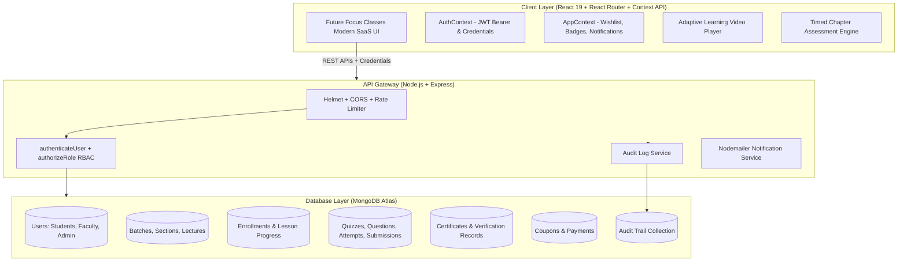

# 🎓 Future Focus Classes — Premier Coaching & Full-Stack Learning Management System (LMS)

<p align="center">
  
  <br />
  <strong>तमसो माँ ज्योतिर्गमय • Offline & Online Institute</strong>
</p>

[](https://reactjs.org/)
[](https://nodejs.org/)
[](https://www.mongodb.com/)
[](LICENSE)

**Future Focus Classes** is a complete, production-grade Educational Coaching & Learning Management System built using the modern **MERN stack** (MongoDB Atlas, Express.js, React 19, Node.js). 

Designed to support the complete educational journey of students:
1. 🏫 **Class 8th to 10th (CBSE & State Boards Foundation)**: Complete Science, Mathematics & NCERT syllabus.
2. 🔬 **Class 11th & 12th (Senior Secondary)**: Board Masterclasses in Physics, Chemistry, Mathematics (PCM) and Biology (PCB).
3. 🎯 **Competition Exams**: Intensive target batches for **IIT-JEE (Main & Advanced)**, **NEET-UG**, and **CUET**.
4. 🎓 **Graduation & College**: Curriculum support for **B.Tech, BCA, B.Sc** in Engineering Mathematics & Computer Science.
5. 💻 **Coding, Tech & Computer Skills**: Real-world **Full-Stack Web Development (MERN)**, Python, and DSA with placement preparation.

---

## 🏛️ System Architecture



---

## 🚀 Key Functional Capabilities

### 1. 👥 Multi-Role RBAC Authorization
- **Student**: Course discovery across 5 academic streams, enrollment, interactive video player, auto-saved curriculum progress, timed quizzes, assignment submissions, tamper-proof certificate downloads, wishlists, and reviews.
- **Instructor / Faculty**: Studio dashboard, course builder (sections, lessons, resources), assignment review & code grading, student roster management, and performance analytics.
- **Admin**: Central platform dashboard, user directory management, course moderation approval/rejection pipeline, coupon management, payment transaction tracking, and an immutable audit trail.

### 2. 🎬 Dedicated Course Learning Player
- Video player with responsive controls, full-screen playback, and playback speed control.
- Real-time curriculum drawer tracking completed lessons, current lecture, quizzes, and project milestones.
- **Automatic Progress Persistence**: Lesson completion calculated dynamically on backend, unlocking certificates at 100%.
- Integrated **Future Focus AI Academic Mentor** capable of explaining concepts, formulas, and syllabus questions.

### 3. 📝 Interactive Quiz & Assessment Engine
- Support for multiple-choice questions (MCQs), multi-select, and true/false formats.
- Instant server-side grading, percentage calculation, pass/fail determination, attempt limits, and detailed answer explanations.

### 4. 🏆 Cryptographic Public Certificate Verification
- Generates tamper-proof certificates upon successful course completion with unique hash IDs (e.g., `LX-2026-CS8891`).
- Public verification route (`/verify/:certificateId`) accessible to recruiters and employers without requiring authentication.
- Built-in **Print / PDF export** mode with print-optimized CSS styles.

### 5. 💳 Payment-Ready Architecture & Coupon Engine
- Prepared for Razorpay order generation and webhook verification with built-in instant test/mock mode.
- Promo coupon engine supporting percentage discounts (e.g., `FUTURE50` and `LEARNX50` for 50% off) and fixed discounts (e.g., `WELCOME20`).

---

## 🔑 One-Click Demo Accounts

The login page (`/login`) includes **1-click credential auto-fill buttons** for instant evaluation:

| Role | Email | Password | Access Capabilities |
| :--- | :--- | :--- | :--- |
| **Admin** | `admin@futurefocus.com` / `admin@learnx.com` | `Password@123` | Platform Metrics, User Management, Course Moderation, Audit Trail |
| **Faculty** | `instructor@futurefocus.com` / `instructor@learnx.com` | `Password@123` | Faculty Studio, Course Builder, Submissions Grading |
| **Student** | `student@futurefocus.com` / `student@learnx.com` | `Password@123` | Student Dashboard, Enrolled Courses, Learning Player, Certificates |

> 🏷️ **Test Coupons Available**: `FUTURE50` (50% Off), `LEARNX50` (50% Off), `WELCOME20` (₹500 Off).

---

## ⚡ Quick Start & Local Setup

### 1. Backend Setup
```bash
cd Backend
npm install
npm run seed     # Populates MongoDB Atlas with Class 8-12, JEE/NEET, College & Coding batches
npm start        # Runs on http://localhost:3000
```

### 2. Frontend Setup
```bash
cd ../Frontend
npm install
npm run dev      # Runs on http://localhost:5173
```

### 3. Run Automated E2E Test Suite
```bash
cd Backend
node test_e2e_flow.js
```
Expected output:
```text
==================================================
🧪 STARTING COMPREHENSIVE LEARNX LMS E2E VERIFICATION
==================================================
✅ [PASS] API Gateway Health Check
✅ [PASS] Fetch Catalog Courses
✅ [PASS] Fetch Course Details with Curriculum
✅ [PASS] Student Login (student@learnx.com)
✅ [PASS] Student Enrolled Courses Fetch
✅ [PASS] Student Progress Tracking Query
✅ [PASS] Public Certificate Verification (/verify/LX-2026-CS8891)
✅ [PASS] Coupon Validation (LEARNX50)
✅ [PASS] Instructor Login (instructor@learnx.com)
✅ [PASS] Instructor Dashboard Overview
✅ [PASS] Admin Login (admin@learnx.com)
✅ [PASS] Admin Dashboard Metrics
✅ [PASS] Admin Audit Trail Retrieval
==================================================
🏁 TEST RESULTS: 13 PASSED | 0 FAILED
==================================================
```

---

## 📜 License
Distributed under the MIT License. Copyright © Future Focus Classes.
